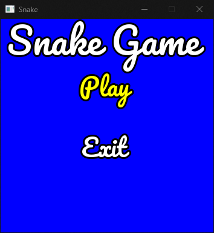
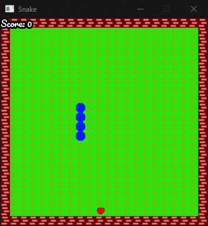
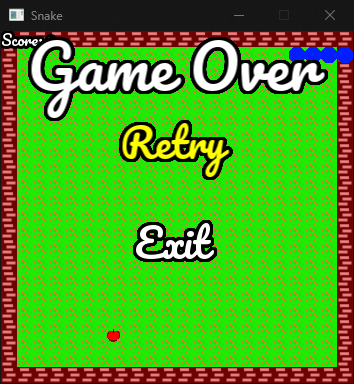

# SnakeGame

The classic Snake in C++ with [SFML](https://www.sfml-dev.org/): eat the apples, grow, and don't hit the walls or
yourself. It has a main menu, a pause menu and a game-over screen, built as a small stack of game states.

| Main menu | Playing | Game over |
|---|---|---|
|  |  |  |

## Controls

| Key | Action |
|---|---|
| ↑ ↓ ← → | Steer the snake; choose a menu item |
| Enter | Select |
| Esc | Pause (in the game) |

## Build and run

You need CMake 3.12+, a C++17 compiler and **SFML 2.5 or 2.6** (SFML 3 changed its API and won't work).

**Linux** (Ubuntu or Debian):

```bash
sudo apt install cmake g++ libsfml-dev
cmake -S . -B build
cmake --build build
./build/SnakeGame
```

**Windows** (Visual Studio 2022 or later):

1. Download *Visual C++ 17 (2022) - 64-bit* from the [SFML 2.6.2 download page](https://www.sfml-dev.org/download/sfml/2.6.2/)
   and unzip it, for example to `C:\SFML-2.6.2`.
2. In a *Developer PowerShell for Visual Studio*, from this folder:

   ```powershell
   cmake -S . -B build -DSFML_DIR=C:/SFML-2.6.2/lib/cmake/SFML
   cmake --build build --config Release
   ```

3. Run `build\SnakeGame.exe` (with the Visual Studio generator: `build\Release\SnakeGame.exe`).

The build copies `assets/` (and on Windows the SFML DLLs) next to the executable, so it also starts with a double-click.

## Code layout

```
main.cpp            creates the Game and runs it
Game/               window, game loop and the shared context
State/              State base class and the StateManager stack
MainMenu/           Play / Exit
GamePlay/           grass, walls, apple, score and collisions
Snake/              the snake's body, movement and growth
PauseMenu/          Resume / Exit
GameOver/           Retry / Exit
ResourceManager/    loads textures and fonts once and hands them out by name
Common/             small math helpers (normalize, clamp)
assets/             textures and the Pacifico font (SIL Open Font License, see assets/fonts/OFL.txt)
```
